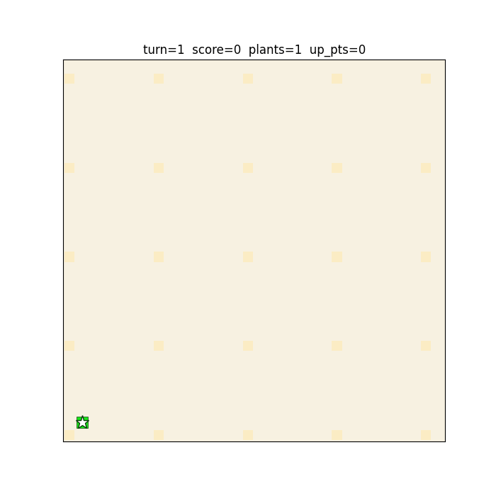
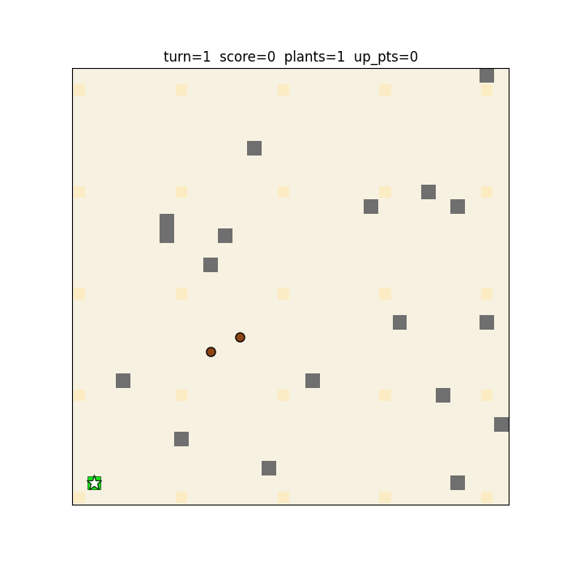

# DatsSol — архив участия в геймтоне

Хакатонное решение для пошаговой стратегии DatSteam: развитие сети плантаций,
терраформация, ремонт, улучшения и противодействие угрозам.

## Что находится в проекте

- Бот на эвристиках: `bot.py`, `strategies.py`, `game_logic.py` и API-клиент.
- Локальный движок игровых правил и среда Gymnasium в `simulator/`.
- Обучение MaskablePPO, imitation learning, учебные стадии и attention/CNN-экстрактор признаков.
- Адаптер для серверного API и сравнение симуляции с записанными раундами.
- Python-dashboard и сохранённые материалы Go-dashboard в `visual/`.
- CSV-дамп раундов в `dump/`, тесты, конфигурации экспериментов и GIF-демонстрации.

## Демонстрации

Эвристическая стратегия в симуляторе:



Обученный агент:



GIF показывают локальные эксперименты и не являются подтверждением места в итоговой таблице соревнования.

## Запуск и проверки

Проверено на Python 3.11: **131 Python-тест проходит**.

```bash
python -m pip install -r requirements.txt
python -m pytest -q
```

Эвристический бот требует действующий токен и доступный сервер:

```bash
export DATSSOL_TOKEN="your-game-token"
python bot.py
```

В PowerShell: `$env:DATSSOL_TOKEN="your-game-token"`.
Для исторического dashboard без обращения к игровому серверу:

```bash
python -m simulator.dashboard.server --dump dump --port 8080
```

Сохранённые веса из Release можно использовать для локальной оценки, например:

```bash
python -m simulator.train.eval --model ppo_s1.zip --stage 1 --episodes 3
```

## Ограничения исходного решения

Симулятор приближает игровую механику. Короткая проверка первых пяти переходов записанных раундов 1 и 2
показала расхождения по очкам, составу плантаций и клеткам. Успешные unit-тесты не подтверждают полного
совпадения с сервером; результаты обучения относятся к соответствующей конфигурации локального симулятора.
Проверка Go-dashboard при публикации не выполнялась.

## Статус архива

Сохранённый снимок хакатонного решения. Активная разработка и поддержка не планируются.
Публикация сохраняет рабочие материалы, включая экспериментальные и незавершённые части.
Игровые серверы организаторов могут быть недоступны; архив не обещает совместимость с их текущим API.
Токены и локальные настройки исключены. Сведения о составе архива — в [ARCHIVE.md](ARCHIVE.md).

## Полный архив

[Release с исходниками и дополнительными материалами](https://github.com/itsZENR/DatsSol/releases/tag/archive-2026-10-22) содержит:

- `source-history.bundle` — Git-историю исходников и сохранённый рабочий снимок;
- `artifacts.zip` — дополнительные исходные материалы, не включённые в основную ветку;
- `SHA256SUMS.txt` — контрольные суммы файлов.

Чтобы восстановить дополнительные файлы, распакуйте `artifacts.zip` в корень клонированного репозитория.
Пути внутри архива соответствуют исходной структуре проекта. Локальная папка `.git`, кэши и настройки помощника в него не входят.

Для этого проекта `artifacts.zip` содержит все сохранённые веса и checkpoints, PKL/PT-файлы,
дубликат CSV-данных Go-dashboard, исходный бинарный dashboard и временные снимки игры.
